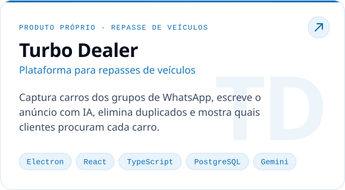
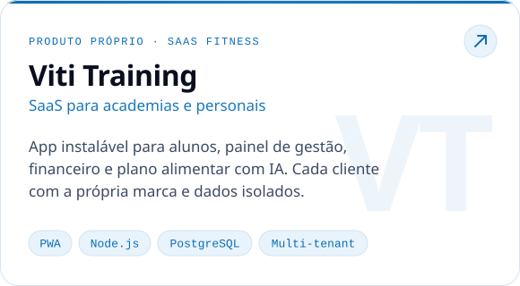
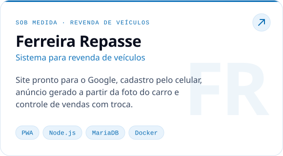
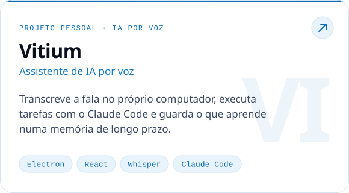
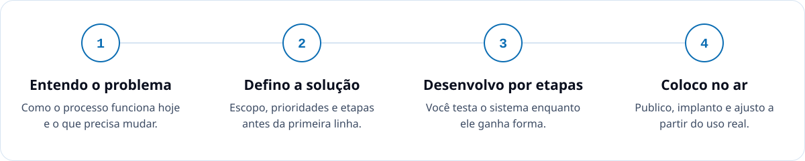
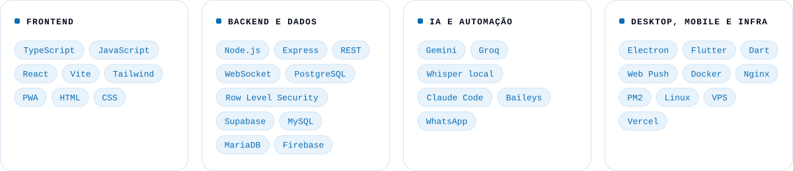
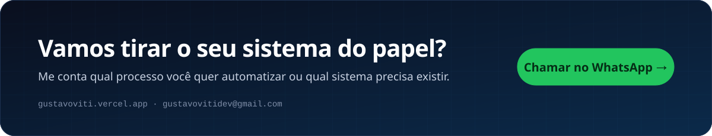

  
  

Crio **sistemas completos de ponta a ponta**: interface, API, banco de dados, integrações e publicação. Quem me contrata fala com uma pessoa só, da primeira conversa ao sistema no ar. Além dos projetos sob medida, desenvolvo **meus próprios produtos**, usados todos os dias por outros negócios.

## Produtos e sistemas no ar

  <a href="https://turbo-dealers.vercel.app"><picture><source media="(prefers-color-scheme: dark)" srcset="assets/turbo-dealer-dark.svg" /></picture></a>
  <a href="https://www.vititraining.com.br/landingpage/"><picture><source media="(prefers-color-scheme: dark)" srcset="assets/viti-training-dark.svg" /></picture></a>
  <a href="https://ferreira-repasse-frontend.vercel.app"><picture><source media="(prefers-color-scheme: dark)" srcset="assets/ferreira-repasse-dark.svg" /></picture></a>
  <a href="https://wa.me/5519995780101?text=Ol%C3%A1%20Gustavo!%20Vi%20seu%20GitHub%20e%20gostaria%20de%20ver%20uma%20demonstra%C3%A7%C3%A3o%20do%20Vitium."><picture><source media="(prefers-color-scheme: dark)" srcset="assets/vitium-dark.svg" /></picture></a>

O código desses produtos é privado. Quer ver funcionando? <a href="https://wa.me/5519995780101">Me chama</a> que eu mostro. Repositórios abertos: <a href="https://github.com/GustavoViti/Nexus">Nexus</a> · <a href="https://github.com/GustavoViti/kaisen">Kaisen</a> · <a href="https://github.com/GustavoViti/Imperios-Burger-APP">Imperios Burger</a>

## Como eu trabalho

<picture><source media="(prefers-color-scheme: dark)" srcset="assets/process-dark.svg" /></picture>

## Stack

<picture><source media="(prefers-color-scheme: dark)" srcset="assets/stack-dark.svg" /></picture>

## Atividade

<picture>
  <source media="(prefers-color-scheme: dark)" srcset="https://raw.githubusercontent.com/GustavoViti/gustavoviti/output/github-snake-dark.svg" />
  
</picture>

 

  
  
  

